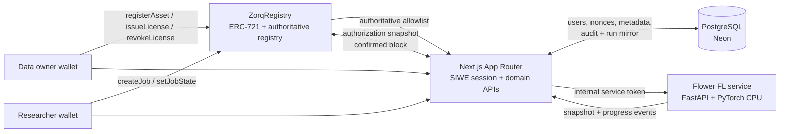

# Zorq

**Programmable authorization for federated machine learning.**

Zorq gives data owners execution-scoped control over their data. A non-transferable ERC-721 DataLicense binds one registered asset to one federated-learning job, its purpose and model-configuration commitments, its validity window and its owner. The Portaldot EVM contract is the authoritative source for that right; the coordinator reads contract state before admitting participants and at every training-round boundary.

The reference deployment demonstrates the complete lifecycle on Portaldot V3 testnet: asset registration, job publication, license issuance, a three-round Flower run, and revocation exclusion at the next round snapshot.

> **Scope:** this is a testnet deployment using generated evaluation data and a Flower demonstration adapter. It does not accept real personal, medical, financial or customer data. It does not claim native Portaldot FL, ZKP, homomorphic-encryption, differential-privacy or secure-aggregation integration.

## Project overview

- **Data owners** register an opaque asset commitment and issue a job-scoped DataLicense.
- **Researchers** publish a fixed-purpose training job with a bounded window and cohort cap.
- **The coordinator** requests one authorization snapshot at one confirmed block per round.
- **The contract** decides authorization; PostgreSQL mirrors metadata and audit history but cannot grant a right the chain denies.
- **Revocation** is terminal for a token and takes effect at the next round boundary. A round already admitted may finish.

## Architecture



The browser never receives database credentials, service tokens or private keys. The FL service calls the web app's internal API only; it does not connect to PostgreSQL directly.

## External databases

Asset registration supports two data sources:

- **Demo Partition** — generated eight-feature evaluation data, one active asset per partition (0–4).
- **External Database** — a read-only PostgreSQL table supplied by the asset owner.

For an external asset the browser sends a PostgreSQL URL, table name and target-label column. The URL is encrypted at rest with AES-256-GCM derived from `SESSION_SECRET`; it is never returned by the asset APIs. The coordinator decrypts it only for the internal authorization snapshot and uses SQLAlchemy/pandas to run:

```sql
SELECT * FROM "table" LIMIT 1000
```

Table and label identifiers are validated against a strict identifier grammar and quoted. The coordinator uses up to eight numeric feature columns, normalizes a binary target, splits rows into train/evaluation tensors and discards the raw rows after the round. If an external connection fails, that participant is marked as a data failure and skipped; the run continues if at least two authorized participants load successfully. External database credentials are testnet/demo credentials only and should never be production secrets.

The schema migration for this feature is `packages/db/migrations/0003_abandoned_vivisector.sql`.

## Live deployment

| Item | Value |
|---|---|
| Web app | <https://zorq-six.vercel.app> (production alias) |
| Preview branch | <https://zorq-git-preview-uhhh2.vercel.app> |
| Contract | `0xa9ab18d404e2cd19c23f30e7d78a740b562685ff` |
| Chain | Portaldot V3 EVM testnet, chain ID `420420777` |
| Deployment transaction | `0xb39268c84b4b62465531cd00659d20364c1ea8ed91cf4995d0fe03e5a02a1834` |
| Deployment block | `337014` |
| FL service | <https://zorq-fl-service.onrender.com> |
| Reference run | `e18c1749-21f4-4cf4-b74a-2ed107f5d6cf` — completed 3/3 |
| Final model hash | `0x1368046d874980a3b0575c9299fe929dc1a29566728f7b105461ad8fef602caf` |
| Revocation evidence | token 3 revoked at block `341655`; denied at snapshot block `341656` |
| Demo video | [`docs/demo/zorq-demo.mp4`](./docs/demo/zorq-demo.mp4) — 2:02 |

The custom `https://zorq-preview-uhhh2.vercel.app` alias currently serves the previous build because Vercel CLI alias mutation is challenge-blocked in this environment. See L-012 in [`AI_HANDOFF.md`](./AI_HANDOFF.md). The two URLs above serve the current UI.

## Repository layout

```text
apps/web/                 Next.js app, API routes, UI and Playwright tests
apps/fl-service/          FastAPI + Flower + PyTorch CPU coordinator
packages/contracts/       ZorqRegistry Solidity contract and Hardhat tests
packages/db/              Drizzle schema, migrations and Postgres client
scripts/demo-video/       Deterministic demo capture and render scripts
docs/                     Architecture, API, deployment, security, testing and design records
```

## Local setup

### Prerequisites

- Node.js `22.23.4` and npm
- Python `3.12` with [`uv`](https://docs.astral.sh/uv/)
- PostgreSQL 15+ locally, or a Neon connection string
- Chromium for Playwright: `npx playwright install chromium`
- Optional: `ffmpeg` for the demo video

### Web app

```bash
nvm use
npm install
cp .env.example .env.local
# Fill .env.local; never commit it.
npm run db:migrate
npm run dev -- --port 3100
```

Open <http://localhost:3100>. The app expects a Substrate wallet extension (polkadot.js, Talisman or SubWallet) and testnet POT for on-chain actions.

### Contracts

```bash
npm --workspace @zorq/contracts run compile
npm --workspace @zorq/contracts test
```

The Portaldot deployment script is `packages/contracts/scripts/deploy-portaldot.ts`. It requires the deployer seed, RPC URL, chain ID and a funded H160 account. Never commit the deployer key.

### FL service

```bash
cd apps/fl-service
uv sync
uv run pytest -q
uv run uvicorn zorq_fl.main:app --host 127.0.0.1 --port 8000
```

The service requires `FL_SERVICE_SHARED_SECRET` and the web app's internal URL. It has no direct database access.

### Checks

```bash
npm run typecheck
npm run lint
npm run build
npm run test
npm run test:auth        # local API + database integration
npm run test:e2e         # Playwright desktop + mobile
```

## Environment variables

Copy [`.env.example`](./.env.example) to `.env.local`. Server-only values must never be prefixed with `NEXT_PUBLIC_`.

| Variable | Scope | Purpose |
|---|---|---|
| `APP_ORIGIN` | Server | Canonical app origin used for SIWE fallback, session issuer and cookie policy. |
| `NEXT_PUBLIC_APP_URL` | Public | Public app URL used in metadata and links. |
| `ALLOWED_ORIGINS` | Server | Optional comma-separated additional trusted browser origins (exact origins only). |
| `SESSION_SECRET` | Server | At least 32 bytes; signs the HttpOnly session token. |
| `DATABASE_URL` | Server | Pooled PostgreSQL/Neon URL. Use `prepare: false` with the pooler. |
| `PORTALDOT_CHAIN_ID` | Server | Must be `420420777` for the V3 testnet. |
| `PORTALDOT_EVM_RPC_URL` | Server | Portaldot V3 EVM RPC endpoint. |
| `PORTALDOT_CONFIRMATION_DEPTH` | Server | Confirmation depth used before accepting chain state. |
| `ZORQ_CONTRACT_ADDRESS` | Server | Deployed `ZorqRegistry` address. |
| `NEXT_PUBLIC_ZORQ_CONTRACT_ADDRESS` | Public | Contract address used by wallet clients. |
| `NEXT_PUBLIC_PORTALDOT_CHAIN_ID` | Public | Chain ID exposed to the wallet client. |
| `NEXT_PUBLIC_PORTALDOT_RPC_URL` | Public | RPC URL exposed to the wallet client. |
| `NEXT_PUBLIC_PORTALDOT_EXPLORER_URL` | Public | Block explorer link for transaction evidence. |
| `NEXT_PUBLIC_GITHUB_REPOSITORY_URL` | Public | Public repository link used by the UI. |
| `RATE_LIMIT_SECRET` | Server | Secret used for rate-limit identifiers. |
| `FL_SERVICE_URL` | Server | Render/FL coordinator URL. |
| `FL_SERVICE_SHARED_SECRET` | Server | High-entropy service-to-service bearer token. |
| `FL_SERVICE_TIMEOUT_MS` | Server | Internal FL request timeout. |
| `ROUND_DELAY_MS` | FL service | Optional pacing delay between rounds. |

## Portaldot deployment details

- **Network:** Portaldot V3 EVM testnet
- **Chain ID:** `420420777`
- **Contract:** `ZorqRegistry` — ERC-721 DataLicense plus authoritative registry in one non-upgradeable contract
- **Deployment:** `revive.instantiateWithCode` with the optimized runtime
- **Deployment transaction:** `0xb39268c84b4b62465531cd00659d20364c1ea8ed91cf4995d0fe03e5a02a1834`
- **Deployment block:** `337014`
- **Runtime code:** `6,861` bytes
- **Owner:** `0xFb7E252faE2D9e5A849361C22d7E4F8be2BB32Bf`
- **`supportsInterface(0x80ac58cd)`:** `true`

The reference run used three active assets and three licenses. Rounds 1 and 2 admitted all three; token 3 was revoked after round 2's snapshot and excluded at the next snapshot while two authorized assets continued. See [`docs/evidence/demo-run.json`](./docs/evidence/demo-run.json) and [`docs/PORTALDOT_VALIDATION.md`](./docs/PORTALDOT_VALIDATION.md).

## Testing

See [`docs/TEST_PLAN.md`](./docs/TEST_PLAN.md). The current suite covers:

- Solidity unit and integration tests (`11/11`)
- FL simulation, external-data and contract-boundary tests (`7/7`)
- SIWE authentication, replay rejection, origin checks and rate limits
- Unit tests for domain formatting, SIWE construction, origin validation and safe client parsing
- Playwright desktop + mobile route/state coverage (`40/40`)
- Deployed-preview sign-in and data-page verification

Every claim in the UI is intended to be backed by a command, a contract read or a recorded run artifact. Do not claim a test passed unless the command actually ran.

## Security and privacy

See [`docs/SECURITY_AND_PRIVACY.md`](./docs/SECURITY_AND_PRIVACY.md).

- Wallet actions are signed in the user's wallet; Zorq never holds a user private key.
- SIWE sessions are HttpOnly, Secure and SameSite cookies; they are stateless and expire.
- Raw evaluation data never leaves the worker runtime. Only commitments and aggregate metrics are retained.
- FL does not automatically protect against update leakage, poisoning or inference.
- The app is testnet-only; do not use it with production or regulated data.

## Project documents

- [`PROJECT_SPEC.md`](./PROJECT_SPEC.md) — product, MVP, flows, requirements and business rules
- [`ARCHITECTURE.md`](./ARCHITECTURE.md) — system architecture, contract, stack and boundaries
- [`IMPLEMENTATION_PLAN.md`](./IMPLEMENTATION_PLAN.md) — phased build sequence
- [`AI_HANDOFF.md`](./AI_HANDOFF.md) — current state, decisions, evidence and known limitations
- [`docs/API_REFERENCE.md`](./docs/API_REFERENCE.md) — implemented HTTP endpoints
- [`docs/DEVELOPER_SETUP.md`](./docs/DEVELOPER_SETUP.md) — local setup detail
- [`docs/DEPLOYMENT.md`](./docs/DEPLOYMENT.md) — Vercel, Neon and Render deployment
- [`docs/FL_SERVICE.md`](./docs/FL_SERVICE.md) — coordinator service
- [`docs/TEST_PLAN.md`](./docs/TEST_PLAN.md) — test matrix and evidence
- [`docs/DESIGN_DECISIONS.md`](./docs/DESIGN_DECISIONS.md) — reference-image implementation record

## Links

- **In-app documentation:** `/docs`
- **GitHub:** <https://github.com/onyebuchidaniel60/Zorq>
- **Portaldot explorer:** <https://scanner-testnet-v3.portaldot.dev/>
