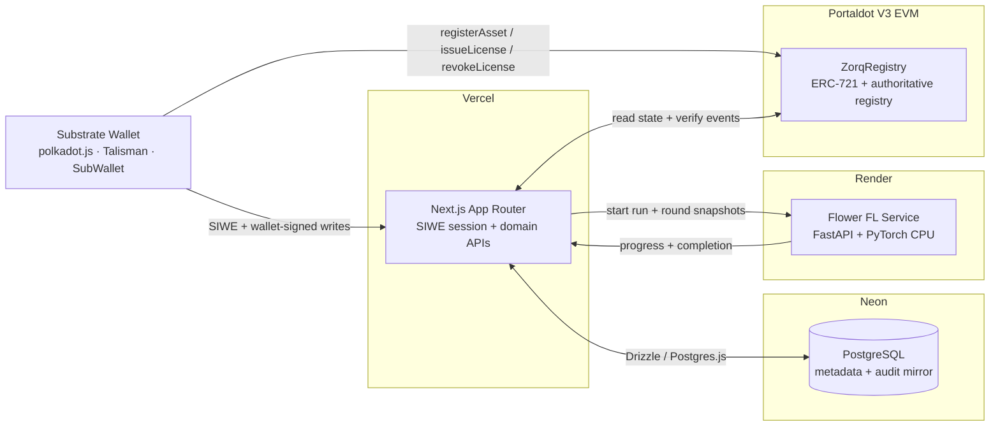

<div align="center">

# Zorq

### Programmable Authorization for Privacy-Preserving Federated AI

<p>
  Job-scoped, non-transferable DataLicenses for federated learning on Portaldot.
</p>

[](https://nextjs.org/)
[](https://www.python.org/)
[](https://soliditylang.org/)
[](https://portaldot-dev.readthedocs.io/en/latest/)
[](https://neon.tech/)

<br/>

[**Live App**](https://zorq-six.vercel.app) · [**Documentation**](https://zorq-six.vercel.app/docs) · [**Demo Video**](./docs/demo/zorq-demo.mp4) · [**Portaldot Explorer**](https://scanner-testnet-v3.portaldot.dev/#/accounts/0xa9ab18d404e2cd19c23f30e7d78a740b562685ff) · [**GitHub**](https://github.com/onyebuchidaniel60/Zorq)

</div>

---

<a id="quick-start"></a>

## 🚀 Quickstart & Live Demo (Judges Start Here)

| Resource | Link |
|---|---|
| **Live application** | <https://zorq-six.vercel.app> |
| **In-app documentation** | <https://zorq-six.vercel.app/docs> |
| **Demo video** | [docs/demo/zorq-demo.mp4](./docs/demo/zorq-demo.mp4) |
| **Deployed contract** | [`0xa9ab18d404e2cd19c23f30e7d78a740b562685ff`](https://scanner-testnet-v3.portaldot.dev/#/accounts/0xa9ab18d404e2cd19c23f30e7d78a740b562685ff) |
| **Deployment transaction** | [`0xb39268c8…2a1834`](https://scanner-testnet-v3.portaldot.dev/#/extrinsics/0xb39268c84b4b62465531cd00659d20364c1ea8ed91cf4995d0fe03e5a02a1834) |
| **Network** | Portaldot V3 EVM testnet, chain ID `420420777` |

### How to Test in 3 Steps

1. **Connect and sign in.** Open the [live app](https://zorq-six.vercel.app/app), connect polkadot.js, Talisman or SubWallet on chain `420420777`, and sign the SIWE message. Sign-in does not send a transaction.
2. **Create the rights.** Register at least two data assets on unused demo partitions, publish a training job, then issue a DataLicense from that job for each active asset. For the revocation demo, register and license a third asset.
3. **Run and revoke.** Start the three-round federated learning run. After round 1 or 2, revoke one license. The next round snapshot excludes that token while the remaining two assets continue.

> [!IMPORTANT]
> **Portaldot testnet tPOT is required.** Contract writes need gas and, when they add storage, a Portaldot storage deposit. A zero-balance wallet cannot register an asset, publish a job or issue a license. Fund the EVM-mapped account through the official testnet method before starting; asset and job registration require materially more than a simple transfer.

---

## 🤔 The Core Problem

Data owners often **cannot simply upload their datasets**. Healthcare, financial and customer data are constrained by privacy regulation, contractual obligations, competitive risk and the simple fact that copying raw data destroys control. Federated learning avoids the upload, but it still needs a trustworthy answer to one question:

> **Who is allowed to contribute which data, to which computation, for how long, and under what purpose?**

Current Web3 access controls usually fail that test:

- **Token-gating is coarse.** A balance or NFT proves ownership, not permission for one specific job, model configuration and time window.
- **Access tokens are transferable.** A right to train on a dataset can be sold or delegated to an unrelated party.
- **Revocation is disconnected from compute.** Revoking a token does not automatically remove a participant at the next training-round boundary.
- **There is no durable authorization snapshot.** A coordinator can read state at different blocks, mix stale and fresh data, or continue after an RPC failure.
- **Purpose and configuration are not bound.** A license for one research purpose can be reused for an unrelated model or objective.

Zorq turns authorization into an on-chain, job-scoped primitive. A **non-transferable ERC-721 DataLicense** binds one asset to one FL job, its purpose and model-configuration commitments, a `[validFrom, validUntil)` interval, and the asset owner's wallet. The contract is the authority. PostgreSQL mirrors metadata and audit history, but it cannot grant a right the chain denies.

---

## ✨ Key Features

### 🔐 DataLicense — Job-scoped ERC-721

One asset. One job. One purpose commitment. One model-configuration commitment. One validity window. One owner. The token is **non-transferable** and cannot be approved or delegated. The asset owner issues and revokes it; the job creator cannot mint rights for someone else's data.

### ♻️ Live Revocation

Revocation is terminal for that token and takes effect at the **next round snapshot**. A round already admitted may finish; the next round must read fresh chain state and exclude the revoked license. If fewer than two distinct assets remain authorized, the round fails closed.

### 📸 Round-Level Authorization Snapshots

Before admission and before every training round, the coordinator reads all candidate licenses from `ZorqRegistry` at **one confirmed block number and hash**. The same allowlist governs local training and aggregation for that round. RPC failure, ambiguous state or fewer than two authorized assets stops the run. No stale or cached allowlist is reused.

### 🗄️ External Database Connector

Asset owners can register a generated demo partition or a **read-only external PostgreSQL table**. The connection URL is encrypted at rest with AES-256-GCM, never returned to the browser, and decrypted only for the internal coordinator snapshot. The FL service reads at most 1,000 rows, normalizes up to eight numeric features and a binary label, then discards the raw rows. A failed external participant is skipped without exposing credentials or crashing the run.

---

## 🏗️ Architecture



**Request path:** Next.js (Vercel) reads and writes metadata in Postgres (Neon), starts and monitors runs in the Flower service (Render), and treats the Portaldot EVM contract as the sole authority for assets, jobs, licenses and round authorization.

The FL service **never connects to PostgreSQL directly**. It calls token-protected internal API endpoints on the Next.js application. The browser never receives database credentials, service tokens or private keys.

### Authorization Flow

```text
Asset owner                 ZorqRegistry                 Coordinator
    │                            │                           │
    ├── registerAsset ──────────►│                           │
    ├── issueLicense ───────────►│                           │
    │                            │◄── snapshot at block N ───┤
    │                            │    confirmed hash         │
    │                            ├── allowlist ─────────────►│
    │                            │                           ├── train
    │                            │                           ├── aggregate
    ├── revokeLicense ──────────►│                           │
    │                            │◄── fresh snapshot N+1 ────┤
    │                            ├── excludes revoked ──────►│
```

---

## 🛠️ Build Your Own (Open Source Template)

This repository is intentionally structured as a **forkable reference implementation**. The contract, web app, FL coordinator and database are separate packages, so you can replace the model, the data source or the hosting provider without rewriting the authorization model.

### Step 1 — Prerequisites

- **Node.js 22.23.4** (see `.nvmrc`) and npm
- **Python 3.12** with [`uv`](https://docs.astral.sh/uv/)
- **PostgreSQL 15+** locally or a [Neon](https://neon.tech/) project
- **A funded Portaldot V3 testnet wallet** with tPOT for gas and storage deposits
- A Substrate wallet extension (polkadot.js, Talisman or SubWallet) for browser signing

```bash
git clone https://github.com/onyebuchidaniel60/Zorq.git
cd Zorq
npm ci
cp .env.example .env.local
```

Fill in `DATABASE_URL`, `SESSION_SECRET`, `RATE_LIMIT_SECRET`, the Portaldot RPC/chain values and the FL service token. Never put server-only values in `NEXT_PUBLIC_*` variables.

### Step 2 — Contract Deployment (Hardhat)

The `ZorqRegistry` contract combines the ERC-721 license and the authoritative registry in one non-upgradeable contract. Deploy it to Portaldot V3:

```bash
npm run build --workspace @zorq/contracts
npm run deploy:portaldot --workspace @zorq/contracts
```

The deployment script reads `.env.local` and the gitignored `.secrets/deployer.json`:

```json
{
  "seed": "0x...",
  "ss58": "5...",
  "h160": "0x..."
}
```

Store the deployer key outside version control and set restrictive file permissions (`chmod 600 .secrets/deployer.json`). The script estimates the contract code storage deposit and aborts before sending if the account balance is insufficient.

The deployment record is written to `packages/contracts/deployments/portaldot-v3.json`. Copy its `contractAddress` into both:

```dotenv
ZORQ_CONTRACT_ADDRESS=0x...
NEXT_PUBLIC_ZORQ_CONTRACT_ADDRESS=0x...
```

### Step 3 — Backend & FL Service Deployment (Render, env setup)

1. Create a Neon PostgreSQL database and set `DATABASE_URL` / `DATABASE_URL_UNPOOLED`.
2. Apply the committed Drizzle migrations:

   ```bash
   npm run db:migrate
   ```

3. Deploy `apps/fl-service` to Render as a **Docker web service**:
   - Root directory: `apps/fl-service`
   - Dockerfile: `apps/fl-service/Dockerfile`
   - Health check: `/health`
4. Set the Render environment:

   ```dotenv
   FL_SERVICE_SHARED_SECRET=<high-entropy-token>
   ZORQ_INTERNAL_API_BASE_URL=https://your-web-app.vercel.app
   FL_SERVICE_MODE=simulation
   FLOWER_MAX_CONCURRENT_RUNS=1
   FLOWER_MAX_PARTICIPANTS=5
   DEMO_DATA_SEED=20261104
   PYTHONUNBUFFERED=1
   ```

5. On the web deployment, set `FL_SERVICE_URL` to the Render service URL and the **same** `FL_SERVICE_SHARED_SECRET`.

The Render service uses CPU-only PyTorch. The internal endpoints require the shared bearer token and must not be exposed through the browser.

### Step 4 — Frontend Deployment (Vercel)

1. Import the repository into Vercel.
2. Set **Root Directory** to `apps/web`, framework to **Next.js**, and Node.js to **22.x**.
3. Add the environment variables from `.env.example`. At minimum:
   - `APP_ORIGIN` and `NEXT_PUBLIC_APP_URL` — the canonical deployment origin
   - `DATABASE_URL` — Neon pooled connection string
   - `SESSION_SECRET`, `RATE_LIMIT_SECRET` — server-only secrets
   - `ZORQ_CONTRACT_ADDRESS` and `NEXT_PUBLIC_ZORQ_CONTRACT_ADDRESS`
   - `PORTALDOT_EVM_RPC_URL`, `NEXT_PUBLIC_PORTALDOT_RPC_URL`, `PORTALDOT_CHAIN_ID=420420777`
   - `FL_SERVICE_URL`, `FL_SERVICE_SHARED_SECRET`
4. Deploy and verify `/api/ready` reports the database, chain and contract as ready.
5. If you use additional Vercel aliases, add their exact origins to `ALLOWED_ORIGINS`. Do not use wildcards.

---

## 💻 Local Development

### Web app

```bash
nvm use
npm ci
cp .env.example .env.local
# Configure DATABASE_URL, SESSION_SECRET, RATE_LIMIT_SECRET and the Portaldot values.
npm run db:migrate
npm run dev -- --port 3100
```

Open <http://localhost:3100>. The app uses a local PostgreSQL instance or Neon; no Docker is required locally. Use `npm run db:reset-test-data` to clear synthetic assets, jobs, licenses, runs and stale idempotency records.

### FL service

In a second terminal:

```bash
cd apps/fl-service
uv sync
FL_SERVICE_SHARED_SECRET=local-dev-token \
ZORQ_INTERNAL_API_BASE_URL=http://localhost:3100 \
FL_SERVICE_MODE=simulation \
uv run uvicorn zorq_fl.main:app --host 127.0.0.1 --port 8000
```

Set `FL_SERVICE_URL=http://localhost:8000` and the same shared secret in `.env.local`.

### Tests and checks

```bash
npm run typecheck
npm run lint
npm test
npm run build
npm run test:e2e

npm --workspace @zorq/contracts test
cd apps/fl-service && uv run pytest -q
```

The browser suite covers desktop and mobile route/state rendering. Contract tests cover ownership, non-transferability, validity boundaries, revocation and authorization reason codes. FL tests cover three-round completion, fail-closed behavior and the FedAvg allowlist filter.

---

## 📂 Repository Structure

```text
Zorq/
├── apps/
│   ├── web/                  Next.js App Router, SIWE auth, wallet UI, domain APIs
│   └── fl-service/           FastAPI + Flower + PyTorch CPU coordinator
├── packages/
│   ├── contracts/            ZorqRegistry Solidity contract, Hardhat tests, deploy scripts
│   ├── db/                   Drizzle schema, migrations, Postgres client
│   └── tsconfig.base.json    Shared strict TypeScript configuration
├── docs/
│   ├── ARCHITECTURE.md       System, contract and authorization architecture
│   ├── PROJECT_SPEC.md       Product scope, flows, data model and acceptance criteria
│   ├── IMPLEMENTATION_PLAN.md  Phased implementation record
│   ├── DEPLOYMENT.md         Vercel, Neon, Render and Portaldot runbook
│   ├── API_REFERENCE.md      Implemented HTTP endpoints
│   ├── SECURITY_AND_PRIVACY.md  Threat model and privacy boundaries
│   ├── TEST_PLAN.md          Test matrix and recorded evidence
│   ├── USER_GUIDE.md         Operator and tester walkthrough
│   ├── AI_HANDOFF.md         Final state, decision log and known limitations
│   └── demo/                 Demo video, narration and capture timeline
├── scripts/
│   ├── db/                   Test-data reset utility
│   └── demo-video/           Playwright capture and ffmpeg render scripts
├── .env.example
├── .gitignore
├── .nvmrc
├── package.json
├── package-lock.json
└── README.md
```

### What Lives Where

- **`apps/web`** — the product surface: SIWE sessions, wallet-signed contract calls, owner-scoped metadata APIs, pending-to-active transaction UX, explorer links and the authorization snapshot service.
- **`apps/fl-service`** — the execution adapter: a fixed three-round binary classifier, in-process Flower simulation, external-database loading and fail-closed round snapshots.
- **`packages/contracts`** — the authoritative `ZorqRegistry`: ERC-721 DataLicenses, job/asset registries, revocation, ERC-721 transfer blocking and authorization queries.
- **`packages/db`** — Drizzle schema and migrations for users, nonces, assets, jobs, licenses, runs, rounds, authorization checks and audit events.
- **`docs/`** — the complete product, architecture, deployment, security, testing and decision record. Start with [docs/README.md](./docs/README.md).

---

<div align="center">

**Built for the Portaldot V3 testnet.**

This is an evaluation deployment. Do not use it with production, regulated or personal data. Federated learning is not automatically privacy-preserving against update leakage, poisoning or inference.

[Documentation](./docs/README.md) · [Security & Privacy](./docs/SECURITY_AND_PRIVACY.md) · [Portaldot Validation](./docs/PORTALDOT_VALIDATION.md) · [GitHub](https://github.com/onyebuchidaniel60/Zorq)

</div>
